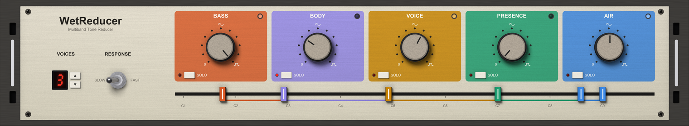

# WET Reducer VST3 Plugin


[](https://github.com/yonie/WetReducer/releases/latest)

This is a creative plugin. Use it to decompose your mix or recording into its raw sine or square waves. The amount of voices and the response determine how much of the original material is reconstructed, and you can also blend the original back in. Solo each band to find the right frequencies and get creative, or just watch the dancing LEDs.

**Download:** [wetvst.com/wetreducer](https://wetvst.com/wetreducer/)

[](https://wetvst.com/wetreducer/)

> **Panel too big or too small?** Right-click anywhere on the panel and pick **UI Zoom** - 75%, 100% or 125%.

## Features

- **Five bands**: BASS, BODY, VOICE, PRESENCE and AIR, each rebuilt from its own loudest notes
- **One knob per band**: from the original sound at 0, through all sine at noon, to all square at full
- **Snapped to notes**: every tone sits on the nearest semitone, so the result is in tune with itself
- **One frequency strip**: six handles on a semitone grid - where BASS starts, the four splits between the bands, where AIR ends. Outside the two outer handles the music passes through untouched
- **VOICES**: how many notes each band plays, 1 to 8. The lowest-pitched of a band's strongest notes are kept; notes more than 12 dB under the loudest are left out
- **RESPONSE**: SLOW waits for a note to last half a second before following it; FAST follows within 50 ms
- **Solo and a note LED per band**: the LED blinks every time its band picks a new note

## Download & Installation

### Windows

1. **Download** the latest release from [wetvst.com](https://wetvst.com/wetreducer/) or [GitHub Releases](https://github.com/yonie/WetReducer/releases)
2. **Extract** the ZIP file
3. **Copy** `WetReducer.vst3` to your VST3 folder:
   - User: `C:\Users\[Username]\Documents\VST3\`
   - System: `C:\Program Files\Common Files\VST3\`
4. **Restart your DAW** and rescan plugins

### Linux

1. **Download** the latest release from [wetvst.com](https://wetvst.com/wetreducer/) or [GitHub Releases](https://github.com/yonie/WetReducer/releases)
2. **Extract** the ZIP file
3. **Copy** `WetReducer.vst3` to your VST3 folder:
   - User: `~/.vst3/`
   - System: `/usr/lib/vst3/`
4. **Restart your DAW** and rescan plugins

### macOS

1. **Download** the latest release from [wetvst.com](https://wetvst.com/wetreducer/) or [GitHub Releases](https://github.com/yonie/WetReducer/releases)
2. **Extract** the ZIP file
3. **Copy** `WetReducer.vst3` to `~/Library/Audio/Plug-Ins/VST3/`
4. **Copy** `WetReducer.component` to `~/Library/Audio/Plug-Ins/Components/` for Logic and GarageBand
5. **Restart your DAW** and rescan plugins

The plug-in is signed and notarised by Apple, so macOS opens it without a warning.

## Usage

1. **Load the plugin** on a full mix, a bus or a single recording
2. **Turn up one band** to noon and listen: that band is now its own loudest notes as sine waves. Past noon the sine turns square
3. **Solo a band** to hear it alone, and drag its handles on the strip until it catches the part you want - the bass line, the chords, the vocal melody
4. **Set VOICES** for how many of each band's notes are rebuilt. One voice is a single line per band; more voices bring more of the source back
5. **Pick a RESPONSE**. SLOW gives steady, held notes; FAST follows quick runs
6. **Keep a little of the original** by setting a band below noon

**Latency:** WetReducer listens ahead to find each note, so it delays the sound by 8192 samples (about 170 ms at 48 kHz). Your DAW compensates for this automatically on playback.

### Parameter Reference

| Parameter | Range | Default | Description |
|-----------|-------|---------|-------------|
| Bass, Body, Voice, Presence, Air | 0-100, 11 detents (41 with Shift) | 0 | 0 the original, 50 all sine, 100 all square |
| Bass from | B0-B9 in semitones | D#1 | Where BASS starts; below it the music passes as it is. At B0 BASS reaches the bottom |
| Bass / Body, Body / Voice, Voice / Presence, Presence / Air | B0-B9 in semitones | A2, B4, C7, G8 | The splits between the bands, at least a major third apart |
| Air up to | B0-B9 in semitones | E9 | Where AIR ends; above it the music passes as it is. At B9 AIR reaches the top |
| Voices | 1-8 | 3 | Notes per band |
| Response | Slow / Fast | Slow | Slow: a note must last 500 ms; Fast: 50 ms |
| Solo (per band) | Off / On | Off | With any solo on, only the soloed bands are heard |

### Mouse

- **Knobs**: drag, or the wheel - one detent per notch, a quarter detent with Shift held
- **Strip handles**: drag, or the wheel over the strip - one semitone per notch for the handle nearest the pointer
- **VOICES**: the up and down buttons beside the display
- **Right-click the panel**: UI Zoom - 75%, 100% or 125%

## Building from Source

Requires CMake 3.15 or higher, a C++17 compiler (Visual Studio 2022 on Windows, GCC or Clang on Linux, Xcode on macOS) and the [VST3 SDK](https://github.com/steinbergmedia/vst3sdk) cloned into `vst3sdk/` with `--recursive`.

```bash
cmake -S WetReducer -B WetReducer/build -DCMAKE_BUILD_TYPE=Release
cmake --build WetReducer/build --config Release
```

The plug-in lands in `WetReducer/build/VST3/Release/WetReducer.vst3`.

## License

MIT - see [LICENSE](LICENSE).
